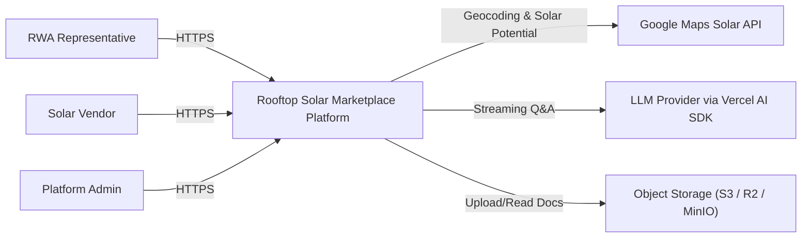
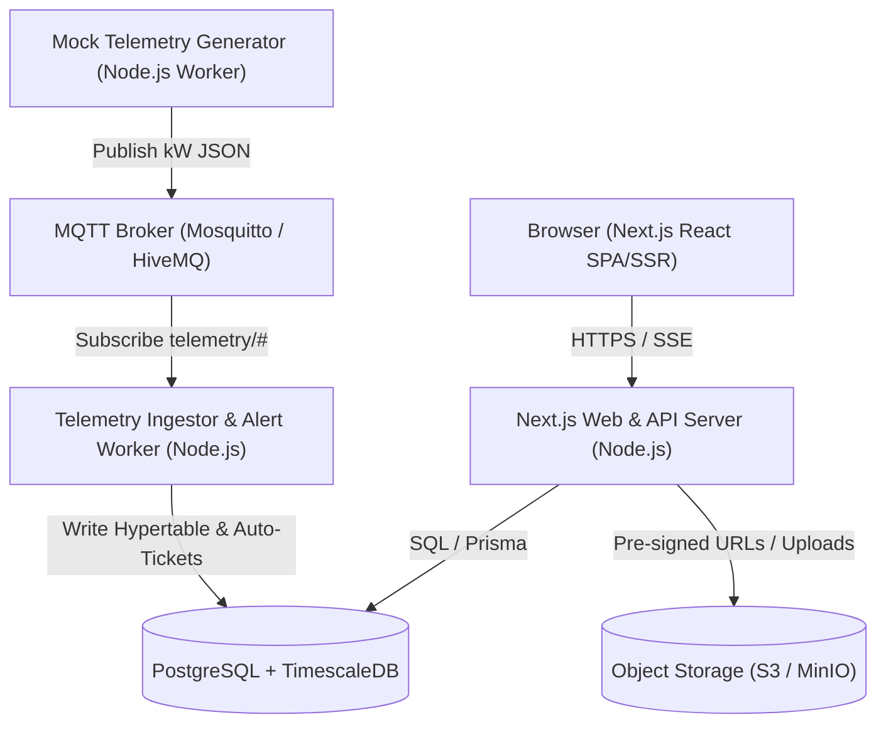

# Software Architecture Document (SAD) — Rooftop Solar Marketplace

**Project:** Rooftop Solar Marketplace ("Airbnb for Solar")  
**Version:** v1.0 (Architecture Lock)  
**Sources:** `product_requirements_document.md`, `website_flow.md`, `tech_stack.md`  

---

## 1. Overview

### 1.1 Purpose
This Software Architecture Document (SAD) defines the system structure, data flows, integration contracts, quality attributes, and architectural decisions for the Rooftop Solar Marketplace prior to frontend or backend implementation. It translates the PRD and `website_flow.md` state machine into an implementable engineering blueprint.

### 1.2 Stakeholders
- **RWA (Housing Society Representative):** Lists rooftops, reviews solar estimates, compares blind bids, records physical audit outcomes and off-platform contracts, monitors generation, and raises support tickets.
- **Solar Vendor:** Completes document verification, browses `Live` roofs, submits blind bids, tracks audit/contract status, monitors contracted fleet, and resolves maintenance tickets.
- **Platform Admin:** Reviews vendor credentials against public empanelment lists (e.g., PM Surya Ghar), approves/rejects/suspends vendors, and inspects disputes read-only.
- **Academic Examiners / Evaluators:** Verify end-to-end software architecture, blind-bid security, AI assistant isolation, and real-time simulated IoT telemetry ingestion.

### 1.3 Glossary
- **RWA:** Residential Welfare Association (housing society).
- **Blind Bid:** A vendor proposal whose price/terms are invisible to competing vendors and only visible to the owning RWA and Platform Admin.
- **RESCO:** Renewable Energy Service Company (third-party solar lease/PPA model with zero/low upfront cost to the RWA).
- **DISCOM:** Electricity Distribution Company.
- **Peak Daylight Window:** Configurable solar generation window (e.g., 09:00–16:00 IST) during which `0 kW` output or prolonged MQTT silence triggers an automated maintenance ticket.

---

## 2. Quality Attributes

| Attribute | Target | Architectural Mechanism |
| :--- | :--- | :--- |
| **Performance** | HTTP REST p95 < 300ms; MQTT-to-Dashboard end-to-end latency < 2s. | Decoupled Node.js MQTT ingestion worker; non-blocking async DB batch writes; TimescaleDB time-bucket queries for charts. |
| **Scalability** | Support 100+ concurrent simulated roofs publishing every 5s (20+ msg/sec) without degrading web UX. | Separate web tier and worker tier; connection pooling; TimescaleDB hypertable partitioning by time. |
| **Reliability** | 99.9% telemetry ingestion uptime; zero single-point-of-failure UX dead ends. | Graceful fallbacks: manual roof entry if Google Maps Solar API fails (`R-03`); bid table remains usable if AI Assistant fails (`R-05`/`R-12`). |
| **Security** | Zero cross-vendor bid leakage; strict RBAC isolation. | Single-role accounts; server-side JWT verification; DB queries scoped by `session.userId` and `session.role`; masked `404` (`S-05`) for unauthorized roof IDs. |

---

## 3. System Views

### 3.1 High-Level Context Diagram

### 3.2 Container Diagram

### 3.3 Component / Layered Architecture (Next.js Server)
1. **Presentation Layer (`app/` routes):** Public (`P-01`–`P-10`), RWA (`R-01`–`R-13`), Vendor (`V-01`–`V-14`), Admin (`M-01`–`M-04`), System (`S-01`–`S-06`).
2. **Auth & RBAC Middleware:** Validates JWT cookie, enforces role + vendor approval gate (`PENDING`/`REJECTED`/`SUSPENDED`).
3. **Domain Service Layer:**
   - `ListingService` (state machine: `Draft` → `Live` → `Audit Scheduled` → `Contracted` → `Closed` / `Withdrawn`)
   - `BiddingService` (enforces 1 pending bid/vendor/roof and blind-bid isolation)
   - `VerificationService` (vendor dossier workflow)
   - `TelemetryService` (queries TimescaleDB aggregates + calculates earnings/carbon)
   - `TicketService` (manual + automated peak-daylight fault tickets)
4. **Data Access Layer:** Prisma ORM + raw TimescaleDB SQL queries.

---

## 4. Data Architecture

### 4.1 Relational Schema (PostgreSQL)
Core tables and relationships:
- `users`: `id`, `email` (unique), `password_hash`, `role` (`RWA` | `VENDOR` | `ADMIN`), `name`, `phone`, `created_at`.
- `vendor_profiles`: `user_id` (PK/FK), `company_name`, `status` (`UNSUBMITTED` | `PENDING` | `APPROVED` | `REJECTED` | `SUSPENDED`), `rejection_reason`, `reviewed_by`, `reviewed_at`.
- `vendor_documents`: `id`, `vendor_id`, `doc_type` (`PAN` | `GST` | `DISCOM`), `file_key`, `uploaded_at`.
- `roof_listings`: `id`, `rwa_id` (FK), `label`, `address`, `city`, `usable_area_sqm`, `sunlight_hours_yr`, `estimated_kw`, `data_source` (`GOOGLE_SOLAR` | `MANUAL`), `shade_note`, `public_note`, `status` (`DRAFT` | `LIVE` | `AUDIT_SCHEDULED` | `CONTRACTED` | `WITHDRAWN` | `CLOSED`), `created_at`, `updated_at`.
- `bids`: `id`, `roof_id` (FK), `vendor_id` (FK), `proposal_type` (`RESCO_LEASE` | `CAPEX` | `SUBSCRIPTION`), `commercial_term`, `proposed_kw`, `timeline_weeks`, `note`, `status` (`PENDING` | `WITHDRAWN` | `ACCEPTED` | `NOT_SELECTED`), `created_at`. *(Unique partial index on `(roof_id, vendor_id)` where `status = 'PENDING'`)*
- `audits`: `id`, `roof_id` (FK), `accepted_bid_id` (FK), `vendor_visit_note`, `outcome` (`PENDING` | `PASSED` | `FAILED_REOPEN` | `FAILED_WITHDRAW`), `recorded_at`.
- `contracts`: `id`, `roof_id` (FK), `bid_id` (FK), `contract_date`, `proposal_type`, `tariff_or_share_rate`, `signed_doc_key`, `system_status` (`ONLINE` | `MAINTENANCE`), `vendor_config_note`, `created_at`.
- `tickets`: `id`, `roof_id` (FK), `vendor_id` (FK), `opened_by` (`RWA` | `SYSTEM`), `category`, `status` (`OPEN` | `RESOLVED`), `created_at`, `resolved_at`.
- `ticket_messages`: `id`, `ticket_id` (FK), `sender_id` (FK, nullable for `SYSTEM`), `body`, `created_at`.

### 4.2 Time-Series Schema (TimescaleDB)
- `telemetry_readings` (Hypertable partitioned by `time`):
  - `time` (`TIMESTAMPTZ`, NOT NULL)
  - `roof_id` (`UUID`, NOT NULL, indexed)
  - `kw_generated` (`DOUBLE PRECISION`, NOT NULL)
  - `device_status` (`TEXT`, e.g., `ONLINE`, `FAULT`, `MAINTENANCE`)
  - `published_at` (`TIMESTAMPTZ`, used for end-to-end latency tracking)

### 4.3 Data Flow & Retention Policies
- **Telemetry Flow:** When a listing transitions to `CONTRACTED`, the Mock Telemetry Generator includes its `roof_id` in its 5-second publish loop. When `CLOSED`, it stops.
- **Retention:** Raw 5-second `telemetry_readings` retained for **30 days**; 15-minute continuous aggregates retained for **2 years**; relational contract/audit records retained indefinitely for compliance.

---

## 5. External Integrations & Communication Protocols

| Integration | Protocol | Contract & Failure Handling |
| :--- | :--- | :--- |
| **Google Maps Solar API** | Sync HTTPS REST (`buildingInsights:findClosest`) | Input: geocoded `lat, lng`. Output: `maxArrayAreaMeters2`, `maxSunshineHoursPerYear`. **Fallback:** On 4xx/5xx/timeout, `[R-03]` stays `DRAFT` and allows manual area/shade entry badged `"Entered by the society"`. |
| **Vercel AI SDK** | Sync HTTPS + Server-Sent Events (Streaming) | Endpoint `POST /api/assistant`. Injects RWA-only system prompt + current listing summary (never other societies' data or rival bids). **Fallback:** `[R-05]` bid table remains functional with `"Assistant unavailable."` banner. |
| **MQTT Broker** | Async MQTT v3.1.1 / v5 over TCP/TLS | Topic: `solar/telemetry/{roof_id}`. Payload: `{ "roofId": "...", "kw": 14.2, "status": "ONLINE", "publishedAt": "ISO-8601" }`. QoS 1 for reliable delivery. |
| **Frontend Live Updates** | Sync HTTPS Polling (every 5s) or SSE | `GET /api/roofs/{id}/telemetry?range=24h` returns recent points, earnings (`kWh × bid rate`), carbon offset, and stale-connection status. |

---

## 6. Architecture Decision Records (ADRs)

### ADR-001: Simulated MQTT Engine vs. Physical IoT Hardware
- **Decision:** Replace physical ESP32/Raspberry Pi hardware with a Node.js Mock Telemetry Generator publishing to an MQTT broker.
- **Alternatives Rejected:** Physical microcontrollers + inverter RS-485 wiring.
- **Trade-offs:** Eliminates hardware procurement and demo-day failure risks while exercising the exact same production MQTT ingestion and time-series pipeline.

### ADR-002: Database-Level Blind Bidding Enforcement
- **Decision:** Enforce blind bidding in PostgreSQL query scopes and service methods; never return competitor bids in vendor API payloads.
- **Alternatives Rejected:** Filtering rival bids on the frontend.
- **Trade-offs:** Slightly more explicit API endpoint separation (`/api/rwa/roofs/[id]/bids` vs `/api/vendor/bids`), but guarantees zero price leakage via browser DevTools.

### ADR-003: TimescaleDB Extension vs. Standalone InfluxDB
- **Decision:** Use TimescaleDB inside PostgreSQL 16 as the time-series store.
- **Alternatives Rejected:** Operating a separate InfluxDB 2.x cluster with Flux queries.
- **Trade-offs:** Sacrifices InfluxDB's specialized Flux ecosystem for unified SQL joins, single-database backups, and simpler Docker Compose orchestration.

### ADR-004: Next.js Web Tier + Separate Persistent MQTT Worker
- **Decision:** Keep the web/API in Next.js and run the Mock Generator + MQTT Ingestor as persistent Node.js worker processes.
- **Alternatives Rejected:** Full microservices (separate Auth, Bidding, Listing services) or running MQTT inside Next.js API routes.
- **Trade-offs:** Avoids distributed microservice overhead while respecting serverless/Next.js lifecycle limits for persistent MQTT subscriptions.

### ADR-005: Manual Admin Verification Gate
- **Decision:** Platform Admin manually verifies vendor PAN, GST, and DISCOM documents against public PM Surya Ghar lists (`M-01`/`M-02`).
- **Alternatives Rejected:** Automated government API integration.
- **Trade-offs:** No official public verification API exists; manual gating ensures trust at the cost of admin review turnaround time.

---

## 7. Observability

- **Health Checks:** `GET /api/health` checks PostgreSQL/TimescaleDB `SELECT 1`, MQTT broker connection state, and worker heartbeat timestamp.
- **Centralized Logging:** Structured JSON logs via `pino` with `requestId`, `userId`, `role`, and `roofId` correlation fields.
- **Metrics & KPI Tracking:**
  - **Telemetry Latency:** Recorded as `ingested_at - published_at` on each MQTT message and exposed in telemetry responses.
  - **Stale & Peak-Daylight Alerting:** Ingestor tracks `last_seen_at` per `Contracted` roof. If `kw === 0` during peak daylight, it immediately opens a `SYSTEM` ticket. If MQTT is silent, dashboards display `"Last reading {time}"` and open a ticket only if silence persists through the peak window.
  - **Funnel Events:** Logged on `RWA_SIGNUP`, `ROOF_PUBLISHED`, `BID_SUBMITTED`, `BID_ACCEPTED`, `AUDIT_PASSED`, and `CONTRACT_CONFIRMED`.

