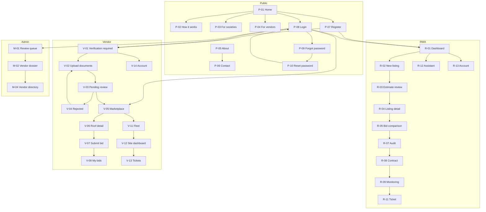
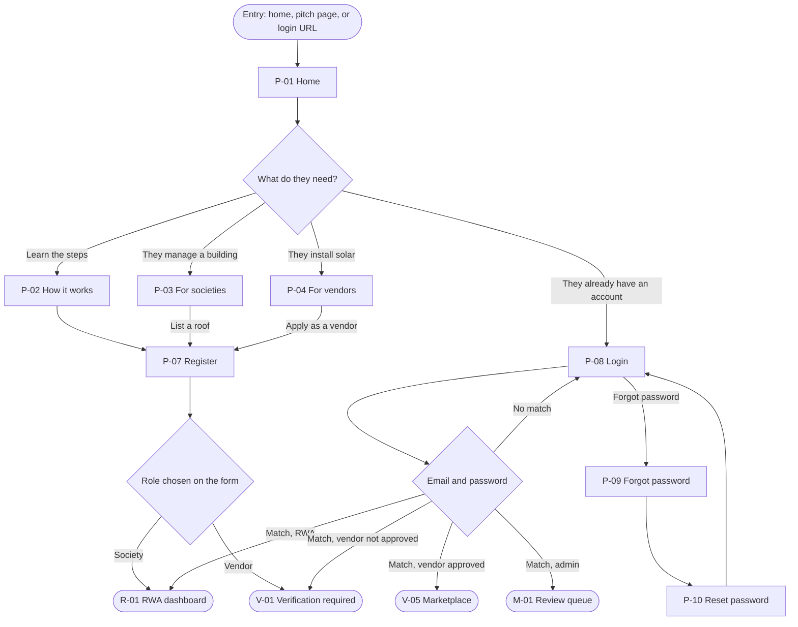
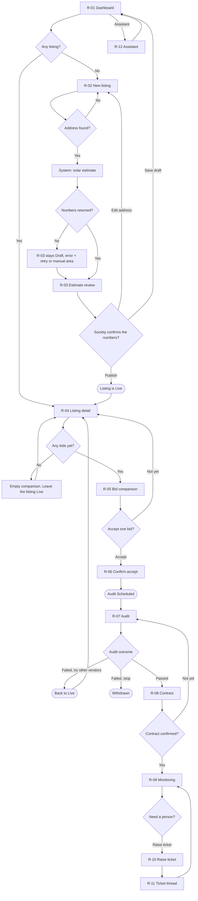
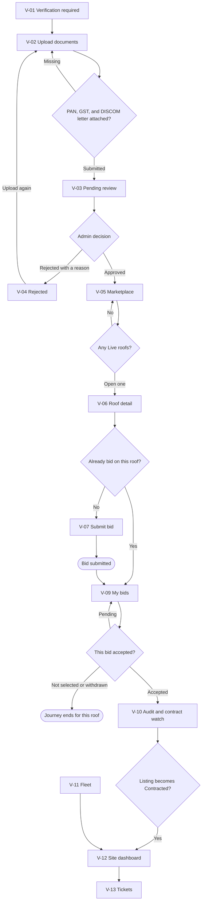
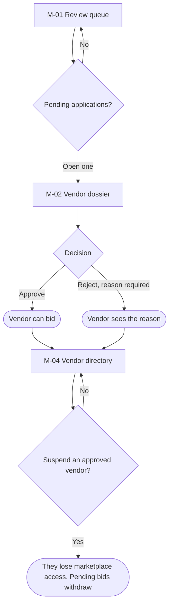
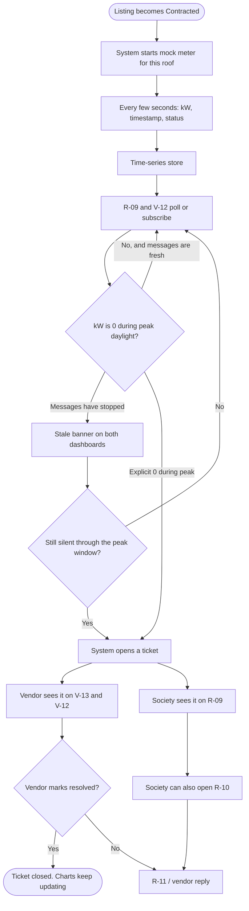

# Website Flow — Rooftop Solar Marketplace

**Product:** Rooftop Solar Marketplace ("Airbnb for Solar")
**Status:** Flow blueprint, pre-code. No screen in this document is built yet.
**Sources:** `product_requirements_document.md` (build spec), `idea_lab_project_details_discussion.pdf` (architecture lock), Idea Lab report and slides (problem and academic framing).
**Where they disagree:** The report and slides still describe physical ESP32 / Raspberry Pi hardware and list MongoDB as an option. The discussion and the PRD replace that with a mock MQTT engine, PostgreSQL for accounts, bids, and contracts, and a time-series store for telemetry. This flow follows the lock.

---

## 1. How to read this document

This is the shared map of how a person moves through the site, from the first URL they open to the moment the product has done its job. Designers, the frontend, and the API should be able to point at a screen ID in section 8 and know what the user can do there, where they go next, and what happens when the step fails.

The marketplace is a **lead-qualification pipeline**. It does not install panels, move money, or replace the site visit. A housing society lists a roof. Verified vendors submit bids they cannot see each other's. The society picks one. The status becomes **Audit Scheduled**. A contract can then be recorded, and only then does the simulated meter start feeding the dashboard.

### Legend

| Shape in the diagrams | Meaning |
| --- | --- |
| Rectangle | A page or screen. ID in brackets, e.g. `[R-04]`. |
| Diamond | A decision. The path splits on a user choice or a system check. |
| Stadium (pill) | An entry point, or an exit where that journey has reached its goal. |
| Arrow | The only legal next step. If a screen has no arrow back to a dashboard, the flow is unfinished. |
| Solid arrow | The user clicks or submits. |
| Dotted arrow | The system does it (API call, status change, auto ticket). |

| Colour in the diagrams | Who is on this path |
| --- | --- |
| Blue | Anyone, including a guest |
| Green | RWA (housing society) |
| Orange | Solar vendor |
| Purple | Platform admin |
| Grey | System, no person clicking |

### Listing statuses (the spine of the product)

A roof listing is always in exactly one of these states. Every later diagram hangs off this list.

| Status | Meaning | Who can change it |
| --- | --- | --- |
| `Draft` | Address saved, roof numbers missing or not confirmed. Hidden from vendors. | RWA saves or deletes it. |
| `Live` | Confirmed roof estimate. Open for blind bids. | RWA withdraws it. A bid does not change this status. |
| `Audit Scheduled` | RWA accepted one bid. Closed to new bids. Other bids are `Not selected`. | RWA records the audit result. |
| `Contracted` | Audit passed and the society confirmed a contract was signed off-platform. Simulator starts. | System, when the RWA confirms the contract. |
| `Withdrawn` | Society took the roof off the market. Open bids close. | RWA, from `Draft`, `Live`, or after a failed audit. |
| `Closed` | Monitoring ended, or the society archived the site. Terminal. | RWA from the monitoring screen. |

Bid statuses, separate from the listing: `Pending`, `Withdrawn` (by that vendor, only while the listing is `Live`), `Accepted`, `Not selected`.

---

## 2. Objectives and personas

**Business goal of the site.** Turn an unused rooftop into a qualified, comparable set of bids, then into one accepted vendor and a live generation view. Success for a demo is: one society lists a roof, two vendors bid without seeing each other, the society accepts one, and the dashboard moves on simulated telemetry.

**Who the site is for.**

| Persona | What they want from one visit | Conversion (the oval at the end of their main path) |
| --- | --- | --- |
| Guest | Understand the product and create the right kind of account. | Account created, or they leave from a public page. |
| RWA committee member | Know if the roof is worth listing, compare bids in plain language, pick one vendor. | Bid accepted → audit scheduled. The later goal is a contracted site they can watch. |
| Solar vendor | Spend time only on roofs that already have area and sunlight numbers, and bid without showing their price to rivals. | Bid submitted on a `Live` roof. The later goal is an accepted bid and a site on their fleet dashboard. |
| Platform admin | Keep unvetted companies out of the bid list. | Vendor approved or rejected with a reason. |

There is no separate investor account. An early notes list mentioned investors. The locked roles are admin, RWA, and vendor. A company that wants to finance a roof uses a vendor account.

**One account, one role.** The same login cannot be both a society and a vendor. Someone who is both in real life creates two accounts. This keeps the blind-bid rule simple: a vendor session is never allowed to run the RWA query that returns every bid.

---

## 3. Entry points

| Entry | Lands on | If already logged in |
| --- | --- | --- |
| Direct visit, bookmark, examiner opening the demo | `[P-01]` Home | Redirect to that role's home (`[R-01]`, `[V-05]` or `[V-01]`, `[M-01]`). |
| Shared link to "how it works", the society pitch, or the vendor pitch | `[P-02]`, `[P-03]`, or `[P-04]` | Stay on that public page. Header shows "Dashboard" instead of "Get started". |
| Shared link to a specific roof (`/roofs/{id}`) | `[V-06]` if the viewer is an approved vendor and the roof is `Live` or they already bid. Otherwise `[P-08]` Login, then return to the roof. An RWA who does not own it sees `[S-05]` Not found. Guests are not shown another society's roof. | Same checks. |
| Email or in-app link after admin approval or rejection | `[V-05]` Marketplace, or `[V-04]` Rejected | Login first if the session is gone, then the same screen. |
| Password-reset link | `[P-10]` Reset password | Works even if another session exists. After save, `[P-08]` Login. |
| Old bookmark to a screen the role cannot open | `[S-06]` Not allowed | Button returns to that role's home. No loop. |

There is no ad landing page, no newsletter wall, and no payment return URL. Those are not part of this product.

---

## 4. Site map

---

## 5. Navigation

The header and footer are on every page. They are how someone leaves a dead end. A flow that depends on the browser Back button is incomplete.

### Public header

Logo → `[P-01]`. Links: How it works `[P-02]`, Societies `[P-03]`, Vendors `[P-04]`, Log in `[P-08]`, Get started `[P-07]`.

### Public footer

About `[P-05]`, Contact `[P-06]`, a one-line trust note: bids are hidden from other vendors, and the site does not take payment for the installation.

### RWA header (after login)

My roofs `[R-01]`, Assistant `[R-12]`, Account `[R-13]`. A listing detail `[R-04]` adds in-page links to Bids, Audit, Contract, and Monitoring, and those links are disabled with a reason until the listing has reached that status. Example: "Monitoring opens after a contract is recorded."

### Vendor header

- Not approved: Verification `[V-01]` and Account `[V-14]` only. Marketplace, My bids, Fleet, and Tickets are absent, not merely greyed out.
- Approved: Marketplace `[V-05]`, My bids `[V-09]`, Fleet `[V-11]`, Tickets `[V-13]`, Account `[V-14]`. Verification stays as a small "Approved" label, not a main item.

### Admin header

Reviews `[M-01]`, Vendors `[M-04]`, Account. Admins do not get a marketplace nav. They do not bid.

### Rules that apply to every role

- The logo goes to that role's home, not to the public homepage, once someone is logged in.
- Opening a URL for another role shows `[S-06]` with one button back to the right home. It does not redirect silently in a loop.
- Session expired shows `[S-04]`. Log in returns the person to the URL they were trying to open.
- Logging out always returns to `[P-01]`.

---

## 6. Guest flow — from arrival to an account

**Objective.** Send a society and a vendor into different accounts without making them read the whole PRD.

**Actions.**

- `[P-01]` explains the four phases in one screen: estimate, blind bids, audit, monitoring. Two buttons: "I manage a society" → `[P-03]`, "I am a solar company" → `[P-04]`. A third text link, Log in, goes to `[P-08]`.
- `[P-02]` is the same four phases with the blind-bid rule and the line "the site visit happens in person; this site records the outcome."
- `[P-07]` fields: full name, email, password, role (Society or Vendor). Vendor also enters company name. Submit creates the account and logs them in. There is no email-verification gate. A duplicate email stays on the form with "An account with this email already exists" and a link to `[P-08]`.
- `[P-08]` fields: email, password. Failure copy is always "Email or password is incorrect." It does not say which one was wrong. Five failures in a row show the same message plus "Wait a minute and try again."
- `[P-09]` asks for email. The screen always says "If an account exists, a reset link is on its way," even when the email is unknown.
- `[P-10]` asks for a new password twice. An expired or used link shows an error and a link back to `[P-09]`.

**Exit.** Society account lands on an empty `[R-01]`. Vendor account lands on `[V-01]`, not on the marketplace.

---

## 7. RWA flow — from an empty dashboard to a watched roof

**Objective.** A non-technical committee member lists one roof, reads bids side by side, and either accepts one or walks away. The map estimate is a qualifier. The audit is still required before anyone treats the numbers as a contract.

### Phase 1 — Listing and estimate

1. `[R-01]` empty state: "No roofs yet" and one button, List a roof → `[R-02]`. If listings exist, each card shows address, status, and bid count. The count is a number. It is not the prices.
2. `[R-02]` asks for the building address and a short label ("A-wing terrace"). Submit calls the map service.
3. Address not found: stay on `[R-02]`, show "We could not place that address", keep what they typed.
4. Address found: the system asks the Google Maps Solar API for usable roof area and sunlight hours, and shows a loading state on `[R-03]`.
5. API returns numbers: `[R-03]` shows area, sunlight hours, and a rough kW estimate, with the sentence "A vendor will still visit. This is only a first look."
6. API fails, times out, or returns no roof: `[R-03]` stays a draft. The society can retry, or type area and a shade note themselves. They cannot publish until area and sunlight (or a manual "unknown sunlight") are filled. Manual numbers are badged "Entered by the society" so vendors know the figure was not from the map.
7. Confirm and publish → status `Live`, toast "Vendors can now bid", land on `[R-04]`.
8. Save draft → `Draft` on `[R-01]`. Delete draft asks for confirmation, then the card is gone.

### Phase 2 — Reading bids

9. `[R-04]` while `Live` and no bids: "No bids yet." The society can edit the public note, withdraw, or open the assistant. They cannot edit the area after publish. A wrong area means withdraw and list again, so vendors are not bidding on a moving target.
10. `[R-05]` is the master table, visible only to this society and to admin. Columns: company name, proposal type (lease / revenue share, or society-funded installation, or subscription), the commercial term they typed, proposed kW, timeline, note, submitted date. Sort by date. No score is invented by the site. The society chooses.
11. `[R-12]` Assistant sits beside this table. Typical questions: what a RESCO contract is, what revenue share means, what happens at the audit. The assistant never accepts a bid and never sees other societies' data. If the model is down, the table still works and a line says "Assistant unavailable."
12. Accept opens `[R-06]`, a confirm step that names the company and states the consequences: this roof closes, every other bid becomes `Not selected`, those companies are not told the winning price, and this company will be able to see the committee contact. Cancel returns to `[R-05]`. Confirm sets `Audit Scheduled`.

### Phase 3 — Audit

13. `[R-07]` explains that the visit is in person. It shows the winning company's name and the contact now shared both ways. The vendor may leave a visit note; the society sees it here.
14. The society records the outcome:
    - **Passed** → `[R-08]`.
    - **Failed, reopen** → status returns to `Live`, the accepted bid becomes `Not selected`, and new bids are allowed. The old bids stay `Not selected`. Vendors who were rejected are not silently re-entered.
    - **Failed, withdraw** → `Withdrawn`. End of this roof's marketplace path.

### Phase 4 — Contract and monitoring

15. `[R-08]` records that a contract was signed outside the site. Fields: contract date, proposal type being confirmed (copied from the winning bid, read-only), an optional file upload of the signed copy. There is no payment form. Confirm sets `Contracted`.
16. The system starts the mock meter for this roof. `[R-09]` shows generation, an earnings estimate, and a carbon estimate. Earnings are `kWh × the tariff or share written on the accepted bid`. The site is not collecting that money.
17. The society can read charts and raise a ticket `[R-10]`. They cannot change inverter settings. The button to do that is not on this screen.
18. From `[R-09]` they can archive the site to `Closed`. That stops the mock meter. It asks for confirmation.

**Primary exit.** `[R-06]` confirmed: audit scheduled.
**Later exit.** `[R-08]` confirmed: contracted, dashboard live.
**Walk-away exits.** Draft deleted, listing withdrawn, audit failed and withdrawn, or they log out from `[R-01]` with a `Live` roof and no bid accepted. That last one is a valid state, not an error.

---

## 8. Vendor flow — from an unvetted company to a fleet dashboard

**Objective.** A company proves it is empanelled, then bids on roofs that already have numbers, without ever seeing a competitor's price.

### Verification gate

1. `[V-01]` says they cannot see roofs until an admin approves them. Button: Upload documents → `[V-02]`.
2. `[V-02]` requires three files: company PAN, GST certificate, DISCOM empanelment letter. Optional note. Submit is disabled until all three are present. After submit, status is `Pending` and the screen is `[V-03]`.
3. `[V-03]` tells them to wait. It does not show roofs. They can replace a file only by waiting for rejection, or the admin can still be reviewing the set they sent. Replacing mid-review is not allowed, so the admin is not reading a moving set of files.
4. Rejection lands on `[V-04]` with the admin's reason, which is mandatory. Upload again returns to `[V-02]` and a new `Pending` review.
5. Approval lands them on `[V-05]`. The header gains Marketplace, My bids, Fleet, and Tickets.

### Bidding

6. `[V-05]` lists `Live` roofs only: label, area, sunlight, rough kW, city, and whether the numbers came from the map or from the society. No bid counts, no prices, no other company names. Filters: city, minimum area. Empty state: "No roofs are open right now."
7. `[V-06]` is one roof. Same public facts. The society's phone and email are not on this page. A note says contact is shared if the society accepts this company's bid.
8. `[V-07]` if they have not bid: proposal type, commercial term (a text field, e.g. "₹3.2 per unit" or "12% revenue share"), proposed kW, timeline, note. Submit → confirmation `[V-08]` "Your price is hidden from other companies" → `[V-09]`.
9. One pending bid per company per roof. The button on `[V-06]` becomes "You already bid" and links to `[V-09]`. They may withdraw that bid while the listing is still `Live`. Withdraw asks for confirmation. They cannot edit the price in place. To change it they withdraw and submit again, and only if the listing is still `Live`.
10. They never get a page that lists other bids. A hand-edited URL for another company's bid returns `[S-06]`.

### After the society decides

11. `[V-09]` rows: roof, their own price, bid status, listing status. `Not selected` does not reveal the winner's price. It may name the fact that another company was chosen, without the term.
12. `Accepted`: `[V-10]` shows audit status, the committee contact, and a box to leave a visit note the society will read on `[R-07]`. The vendor does not mark the audit passed. The society does.
13. When the listing becomes `Contracted`, the roof appears on `[V-11]` Fleet and opens `[V-12]`.
14. `[V-12]` shows the same charts as the society, plus write actions: system status (online / maintenance), a short configuration note, and resolve ticket. Those writes are stored with the contract record. They do not pretend to push settings to a real inverter in this phase.
15. `[V-13]` is the list of tickets for their sites, including ones the system opened.

**Primary exit.** `[V-08]` bid submitted.
**Later exit.** `[V-12]` the site is on their fleet.
**Walk-away exits.** Application rejected and they stop, bid withdrawn, bid not selected, or they browse `[V-05]` and leave.

---

## 9. Admin flow — vendor review

**Objective.** Decide, from documents, whether a company may bid. The admin is not a party to the lease.

1. `[M-01]` is the admin home. Queue of `Pending` companies, oldest first. Empty state: "No one is waiting."
2. `[M-02]` shows company name, email, the three files, and the date submitted. The admin checks the company against the public PM Surya Ghar empanelled list. The site does not call a government API. The screen says that the check is manual.
3. Approve → company status `Approved`, they next land on `[V-05]`. Reject → reason required, company status `Rejected`, they next land on `[V-04]`.
4. `[M-04]` lists every company and status. Suspend is for an approved company that should lose access. Suspending withdraws their `Pending` bids and blocks `[V-05]`. Their contracted sites stay visible to the society on `[R-09]`, with a banner "This company is suspended." Tickets already open remain. They cannot submit new bids.
5. Admin can open a read-only view of any listing and its bids from `[M-04]` via the company, for a dispute. Admin cannot accept a bid for a society.

**Exit.** Approve or reject on `[M-02]`.

---

## 10. Assistant flow

The assistant is a side path. It never changes a listing status, a bid, or a ticket.

| | |
| --- | --- |
| Who | Logged-in RWA only, in v1. Vendors are expected to know the terms. |
| Where | `[R-12]`, also linked from `[R-05]` so they can ask while comparing. |
| Scope | RESCO, lease versus capital purchase, what an audit is for, how to read the estimate, how blind bidding works on this site. |
| Not in scope | Legal advice presented as a lawyer, other societies' roofs, other vendors' hidden bids, placing or accepting a bid. |
| Empty | Suggested questions, three of them, so the screen is not a blank box. |
| Loading | The user's message stays visible, the reply area shows a working state. |
| Failure | "Assistant unavailable. You can keep comparing bids." The rest of `[R-05]` still works. |
| Exit | Back to the screen they came from. |

---

## 11. Telemetry and ticket flow

This path starts only when a listing becomes `Contracted`. Until then, monitoring links are disabled.

**Rules.**

- Night-time zero generation does not open a ticket. The condition is zero, or silence, during peak daylight.
- A stale banner is not itself a ticket. A ticket opens if the gap lasts through the peak window, so a one-second MQTT blip does not page the vendor.
- The society can open a ticket even when the charts look fine (`[R-10]`: category, description). That ticket is assigned to the winning vendor.
- The vendor resolves it on `[V-12]` or `[V-13]`. The society sees the reply on `[R-11]` and cannot close it themselves. If they disagree, they add a reply, which reopens it.
- Stopping the meter (site archived to `Closed`) stops new tickets.

**Exit.** Ticket closed, dashboards still live. Or the society archives the site.

---

## 12. Screen inventory

Every screen the site needs. "Next" is the success path. Failures are in section 13.

### Public

| ID | Screen | User can | Next |
| --- | --- | --- | --- |
| P-01 | Home | Read the four phases, pick a side, log in | P-03, P-04, P-08, P-02 |
| P-02 | How it works | Read the path, including blind bids and the in-person audit | P-07 |
| P-03 | For societies | Read what a committee does and does not have to pay up front | P-07 with role Society |
| P-04 | For vendors | Read the verification gate and the blind-bid rule | P-07 with role Vendor |
| P-05 | About | Read what the project is, including that hardware is simulated for this phase | P-01 |
| P-06 | Contact | Send a name, email, and message to the project owner. This is not a maintenance ticket | Confirmation on the same page |
| P-07 | Register | Create one account of one role | R-01 or V-01 |
| P-08 | Login | Enter email and password | Role home |
| P-09 | Forgot password | Ask for a reset link | Same page, generic confirmation |
| P-10 | Reset password | Set a new password from a link | P-08 |

### RWA

| ID | Screen | User can | Next |
| --- | --- | --- | --- |
| R-01 | Dashboard | See their roofs and statuses, start a listing | R-02, R-04, R-12, R-13 |
| R-02 | New listing | Enter address and label | R-03, or stay here if the address fails |
| R-03 | Estimate review | Read area, sun, rough kW. Retry, enter numbers manually, publish, or save draft | R-04 if published, R-01 if draft |
| R-04 | Listing detail | Read status, withdraw, jump to the step this status allows | R-05, R-07, R-08, R-09 |
| R-05 | Bid comparison | Read every bid on this roof, open the assistant, choose one | R-06 |
| R-06 | Confirm accept | Confirm or cancel the consequences | R-07, or back to R-05 |
| R-07 | Audit | Read the winner and their visit note. Record pass, reopen, or withdraw | R-08, R-04, or withdrawn end |
| R-08 | Contract | Confirm a contract was signed off-platform. Optional file | R-09 |
| R-09 | Monitoring | Read charts, earnings estimate, carbon estimate. Raise a ticket. Archive | R-10, R-11 |
| R-10 | Raise ticket | Category and description | R-11 |
| R-11 | Ticket thread | Read and reply | R-09 |
| R-12 | Assistant | Ask about terms and how the site works | Back |
| R-13 | Account | Name, email, password, log out | P-01 after log out |

### Vendor

| ID | Screen | User can | Next |
| --- | --- | --- | --- |
| V-01 | Verification required | See why the marketplace is closed | V-02 |
| V-02 | Upload documents | Attach PAN, GST, DISCOM letter | V-03 |
| V-03 | Pending review | Wait. No roofs | V-05 after approval, V-04 after rejection |
| V-04 | Rejected | Read the reason | V-02 |
| V-05 | Marketplace | Browse `Live` roofs | V-06 |
| V-06 | Roof detail | Read public roof facts only | V-07 or V-09 |
| V-07 | Submit bid | Send one blind proposal | V-08 |
| V-08 | Bid confirmation | Read that the price is hidden | V-09 |
| V-09 | My bids | See only their bids. Withdraw while `Live` | V-06, V-10 |
| V-10 | Audit watch | Read status, see committee contact, leave a visit note | V-12 once contracted |
| V-11 | Fleet | List contracted sites | V-12 |
| V-12 | Site dashboard | Read charts. Write status, configuration note, resolve ticket | V-13 |
| V-13 | Tickets | Open a ticket thread for their sites | V-12 |
| V-14 | Account | Company name, email, password, log out | P-01 after log out |

### Admin

| ID | Screen | User can | Next |
| --- | --- | --- | --- |
| M-01 | Review queue | Open the oldest pending company | M-02 |
| M-02 | Vendor dossier | Read files. Approve, or reject with a reason | M-01 |
| M-04 | Vendor directory | See all companies. Suspend an approved one. Open a read-only bid view for a dispute | M-02 |

### System screens (any role)

| ID | Screen | When | Way out |
| --- | --- | --- | --- |
| S-01 | Empty state | Rendered inside R-01, R-05, V-05, V-09, V-11, V-13, M-01, R-11. Not a separate URL | The primary button of that screen |
| S-02 | Loading | Inside R-03 while the solar API runs, and inside R-09 / V-12 while the first points arrive | Replaced by content or by S-03 |
| S-03 | Error | A request failed and the user can retry | Retry, or back to the role home |
| S-04 | Session expired | JWT missing or expired on a private URL | P-08, then back to the URL |
| S-05 | Not found | Unknown roof id, or a roof this person must not know exists. Unknown roofs and forbidden roofs look the same for vendors and RWAs who are not the owner, so ids are not a directory | Role home, or P-01 if logged out |
| S-06 | Not allowed | Logged in, wrong role, or a vendor hitting the marketplace while unapproved | One button to the correct home. Unapproved vendors go to V-01, not to an error with no next step |

---

## 13. States, edge cases, and the copy the screen must show

| Situation | What the person sees | Where they can go |
| --- | --- | --- |
| Wrong password | "Email or password is incorrect." Fields kept except the password | Stay on P-08. Link to P-09 |
| Duplicate email at register | "An account with this email already exists." | P-08 |
| Reset link expired | "This link has expired." | P-09 |
| Vendor opens `/marketplace` before approval | Not S-06. Send them to V-01 so the next step is obvious | V-02 |
| Vendor opens another company's bid URL | S-06. Do not confirm that the bid exists | Their home |
| RWA opens a roof that is not theirs | S-05 | R-01 |
| Guest opens `/roofs/{id}` | P-08, then the roof only if they are an approved vendor or the owning RWA | P-07 if they have no account |
| Solar API down | R-03 error: "The map estimate is unavailable." Retry, or enter area manually. Status stays `Draft` | R-02 to fix the address |
| Solar API returns a roof that looks wrong | They can go back to R-02 before publish. After publish, area is frozen. They withdraw and start again | R-04 withdraw |
| Publish with blank area | Button disabled. Helper: "Add a roof area before vendors can see this." | Stay on R-03 |
| Live roof, zero bids | R-05 empty: "No bids yet. Companies can see this roof." | R-04, R-12 |
| Two bids, society not ready | They leave. Status stays `Live`. Nothing is auto-accepted | R-01 |
| Accept, then cancel on R-06 | No status change | R-05 |
| Society withdraws while bids are pending | Confirm dialog names the number of bids that will close. Each vendor's row becomes `Not selected` with reason "Roof withdrawn." Prices stay hidden | R-01 |
| Vendor withdraws their only bid | Roof stays `Live` for everyone else | V-09 |
| Vendor tries a second bid on the same roof | V-07 is not offered | V-09 |
| Audit reopen | Winner's bid becomes `Not selected`. Roof is `Live` again. Contact details hide again | R-04 |
| Contract screen opened before audit passed | Link disabled on R-04: "Available after the audit is marked passed." | R-07 |
| Monitoring opened before contract | Link disabled: "Available after a contract is recorded." | R-08 |
| First telemetry points not in yet | R-09 and V-12 loading, then "Waiting for the first reading." Not a ticket | Stay |
| Explicit 0 kW in peak daylight | Auto ticket, banner on both dashboards | V-13, R-11 |
| MQTT silence | "Last reading {time}." Ticket only if the gap lasts through the peak window | Same |
| Zero at night | Charts show zero. No ticket, no banner | Stay |
| Assistant down | Banner on R-12 and R-05. Bids still usable | R-05 |
| File upload fails on V-02 or R-08 | The form keeps the other fields. "That file did not upload. Try again." | Same screen |
| Admin reject with an empty reason | Button disabled. "Write a reason the company will see." | M-02 |
| Suspended vendor's old contract | Society still sees R-09. Banner that the company is suspended. Vendor cannot open V-05 | V-01 style "Account suspended" on login, plus V-14 |
| Contact form P-06 fails | "Message not sent. Try again." | P-06 |
| Logged-in person opens P-07 | Redirect to their role home. Do not create a second role on this account | Role home |

---

## 14. What is deliberately not a path

These showed up in drafts or in the report. They are not screens, so nobody should add a box for them later and call it part of v1.

- Physical device setup, Wi-Fi provisioning, or an inverter login.
- A payment, escrow, subsidy disbursement, or invoice checkout. Earnings on R-09 are a calculation.
- Automated lookup of PM Surya Ghar. The admin reads the public list themselves.
- An investor role, a public bid board, or a vendor-to-vendor message thread.
- Editing roof area after the listing is `Live`.
- A vendor marking their own audit as passed.
- The society changing inverter settings.
- Email verification as a blocker to listing or bidding.

---

## 15. Flow rules locked by this document

The PRD left these as gaps. They are decided here so the arrows do not stop in mid-air. Change them in this file before building, not inside a one-off screen.

1. One account has one role.
2. Vendors see a roof's location and solar numbers, and see the committee's contact only after their bid is the accepted one.
3. Accepting a bid closes the listing. Other bids become `Not selected` without the winning price.
4. The society, not the vendor, records the audit result. Failure can reopen the roof or withdraw it.
5. A failed or empty solar estimate cannot be published. Manual numbers are allowed and labelled.
6. Confirming the contract starts the mock meter. No money moves on the site.
7. The society is read-only on the plant and can raise a ticket. The vendor can write status and configuration notes and can resolve tickets.
8. A zero reading opens a ticket only in peak daylight. Silence shows a stale banner first.

Still open, and not required to draw the flow: which chart component draws R-09, and the examiner date.
